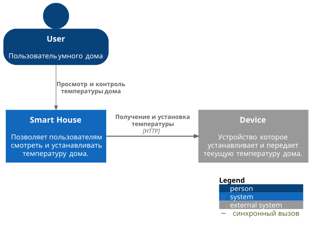
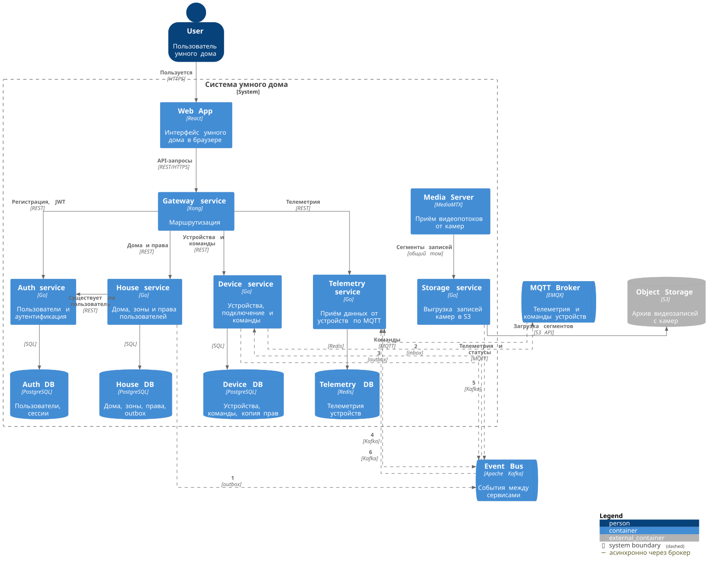
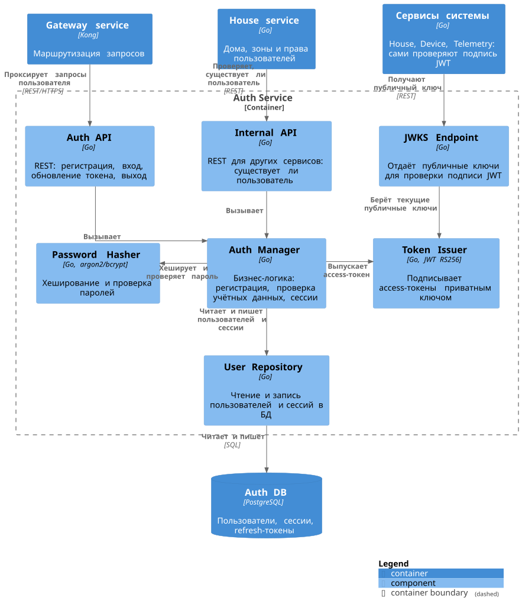
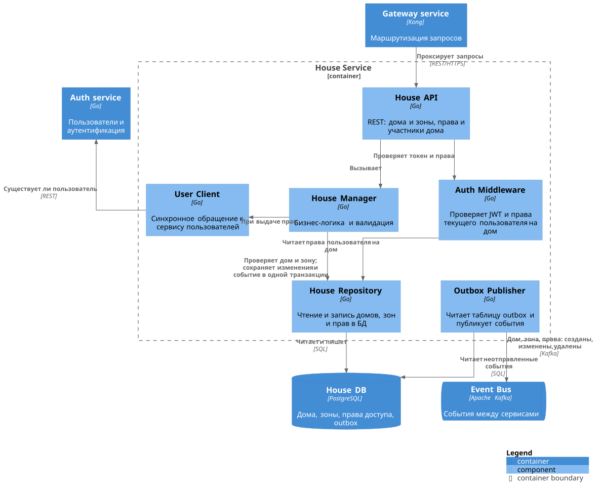
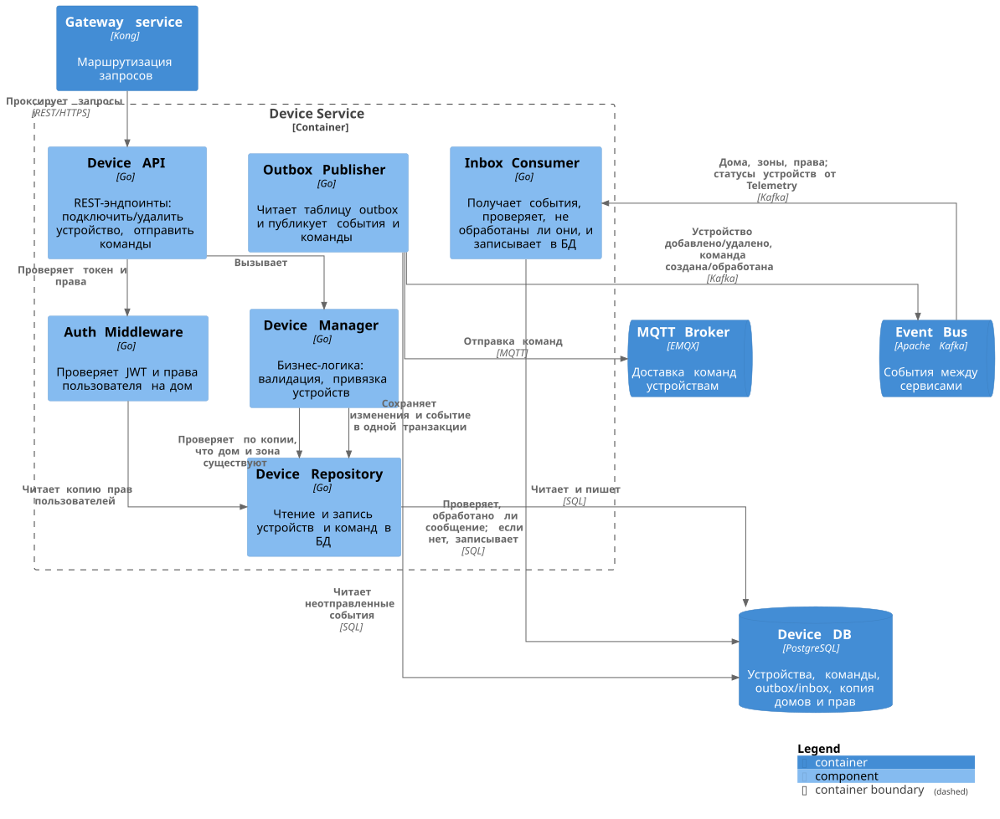
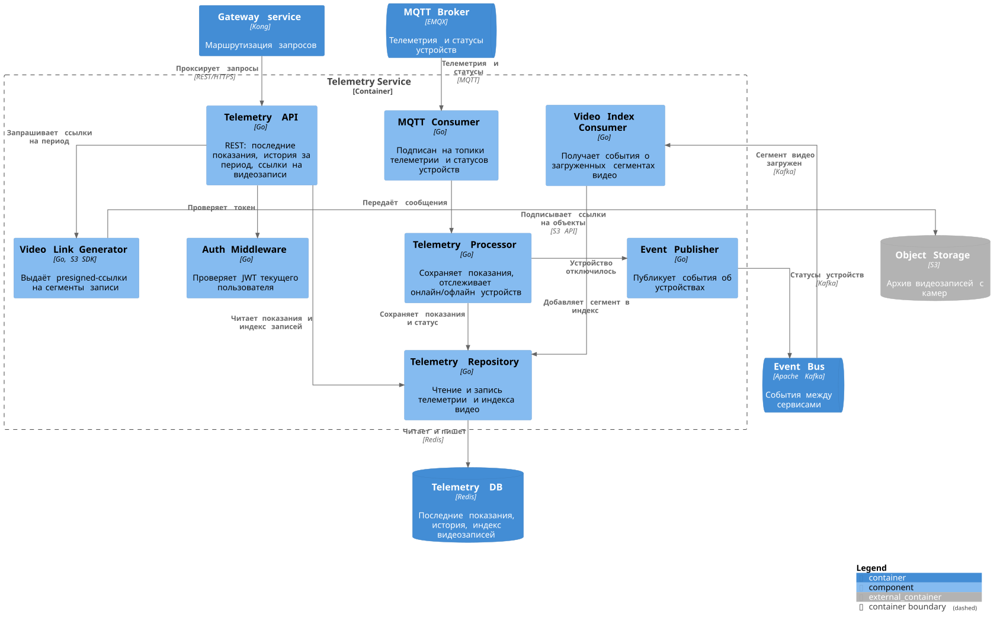
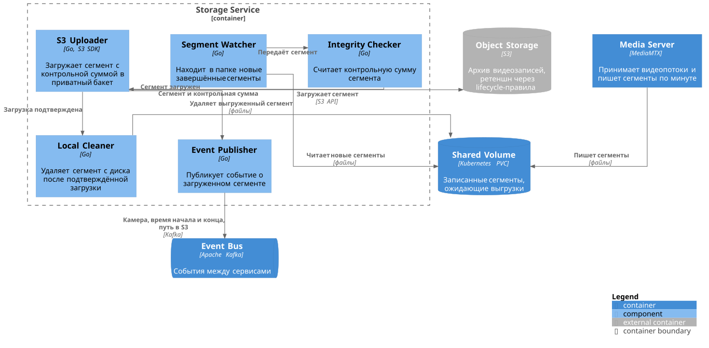
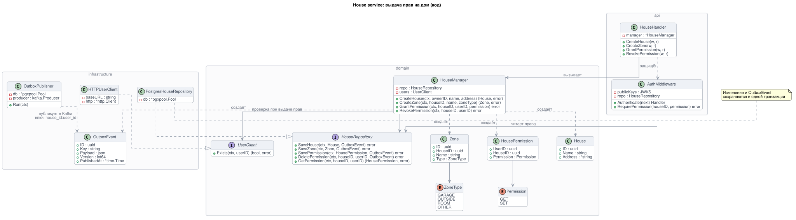
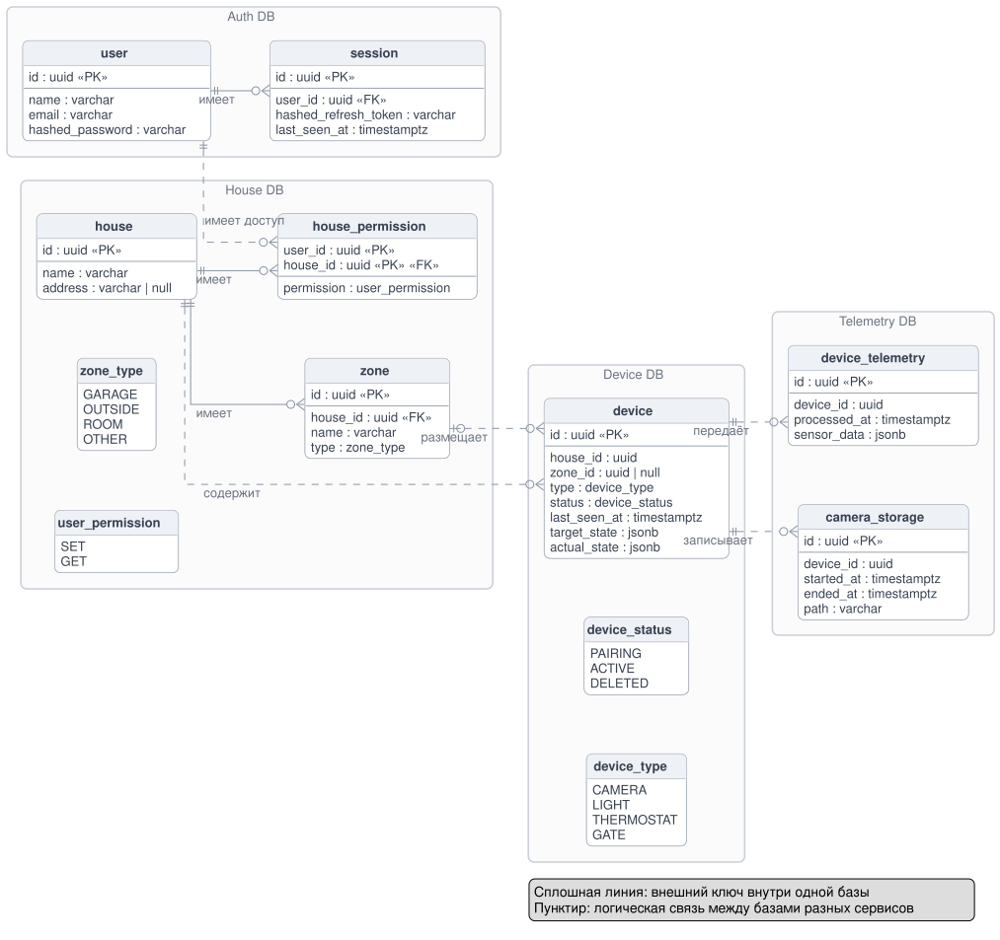

# Project_template

Это шаблон для решения проектной работы. Структура этого файла повторяет структуру заданий. Заполняйте его по мере работы над решением.

# Задание 1. Анализ и планирование

<aside>

Чтобы составить документ с описанием текущей архитектуры приложения, можно часть информации взять из описания компании и условия задания. Это нормально.

</aside

### 1. Описание функциональности монолитного приложения

**Управление отоплением:**

- Пользоватеои могут получать информацию о установленной температуре дома
- Пользователи могут установить необзодимую температуру

**Мониторинг температуры:**

- Пользователи могут получачть температуру своего дома, при этом если происходит какая либо ошибка при получении температуры - пользователь получается старые данные температуры.

### 2. Анализ архитектуры монолитного приложения

Перечислите здесь основные особенности текущего приложения: какой язык программирования используется, какая база данных, как организовано взаимодействие между компонентами и так далее.

- Язык программирования: Go
- База данных: PostgreSQL
- Архитектура: Система получает все данные о температуре сихронно и обходит все датчики в цикле. Все приложение - монолитное
- Развертывание: Требует остановки всего приложения. 

### 3. Определение доменов и границы контекстов

Опишите здесь домены, которые вы выделили:
- Дом
- Управление устройствами
- Телеметрия
- Пользователь

### **4. Проблемы монолитного решения**

- Добавление нового устройства сопровождается выездом специалиста по подключению 
- Если сервис недоступен то пользователь получает старую температуру. При этом полученная температура не записывается в БД, а пользователь получает температуру которая проставляется PATH запросом.
- Опрос температуры проходит синхронно на каждый из датчиков. Если датчиков много. То этот обход займет очень много времени.

Если вы считаете, что текущее решение не вызывает проблем, аргументируйте свою позицию.

### 5. Визуализация контекста системы — диаграмма С4

[](docs/diagrams/context.puml)

# Задание 2. Проектирование микросервисной архитектуры

В этом задании вам нужно предоставить только диаграммы в модели C4. Мы не просим вас отдельно описывать получившиеся микросервисы и то, как вы определили взаимодействия между компонентами To-Be системы. Если вы правильно подготовите диаграммы C4, они и так это покажут.

**Диаграмма контейнеров (Containers)**

[](docs/diagrams/container.puml)

**Диаграмма компонентов (Components)**

*Auth service*

[](docs/diagrams/components/auth_service.puml)

*House service*

[](docs/diagrams/components/house_service.puml)

*Device service*

[](docs/diagrams/components/device_service.puml)

*Telemetry service*

[](docs/diagrams/components/telemetry_service.puml)

*Storage service*

[](docs/diagrams/components/storage_service.puml)


**Диаграмма кода (Code)**

*House service: выдача прав на дом*

[](docs/diagrams/code/house_service.puml)

# Задание 3. Разработка ER-диаграммы

[](docs/diagrams/er.puml)

# Задание 4. Создание и документирование API

### 1. Тип API

Укажите, какой тип API вы будете использовать для взаимодействия микросервисов. Объясните своё решение.

### 2. Документация API

Здесь приложите ссылки на документацию API для микросервисов, которые вы спроектировали в первой части проектной работы. Для документирования используйте Swagger/OpenAPI или AsyncAPI.

- [Device service — OpenAPI](docs/api/device-service.openapi.yaml)

# Задание 5. Работа с docker и docker-compose

Перейдите в apps.

Там находится приложение-монолит для работы с датчиками температуры. В README.md описано как запустить решение.

Вам нужно:

1) сделать простое приложение temperature-api на любом удобном для вас языке программирования, которое при запросе /temperature?location= будет отдавать рандомное значение температуры.

Locations - название комнаты, sensorId - идентификатор названия комнаты

```
	// If no location is provided, use a default based on sensor ID
	if location == "" {
		switch sensorID {
		case "1":
			location = "Living Room"
		case "2":
			location = "Bedroom"
		case "3":
			location = "Kitchen"
		default:
			location = "Unknown"
		}
	}

	// If no sensor ID is provided, generate one based on location
	if sensorID == "" {
		switch location {
		case "Living Room":
			sensorID = "1"
		case "Bedroom":
			sensorID = "2"
		case "Kitchen":
			sensorID = "3"
		default:
			sensorID = "0"
		}
	}
```

2) Приложение следует упаковать в Docker и добавить в docker-compose. Порт по умолчанию должен быть 8081

3) Кроме того для smart_home приложения требуется база данных - добавьте в docker-compose файл настройки для запуска postgres с указанием скрипта инициализации ./smart_home/init.sql

Для проверки можно использовать Postman коллекцию smarthome-api.postman_collection.json и вызвать:

- Create Sensor
- Get All Sensors

Должно при каждом вызове отображаться разное значение температуры

Ревьюер будет проверять точно так же.


